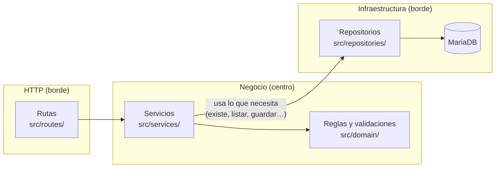

# Arquitectura: ¿dónde queda la base de datos?

ISPAdmin aplica la **D de SOLID (inversión de dependencias)**: la lógica del
negocio no conoce la base de datos. La BD sigue en el dibujo, pero **en el
borde**, detrás de los repositorios.



| Capa | Carpeta | Qué hace | ¿Usa la BD? |
|---|---|---|---|
| Rutas | `src/routes/` | Traducen HTTP: leen la petición, llaman al servicio y arman la respuesta | No |
| Servicios | `src/services/` | Lógica del negocio: cálculos, transacciones, qué se puede hacer | No |
| Dominio | `src/domain/` | Reglas puras: validaciones, value objects (`ClienteId`), tablas de reglas | No |
| Repositorios | `src/repositories/` | Todo el SQL | **Sí** |
| Infraestructura | `src/config/`, `src/database/`, `src/migrations/` | Conexión, transacciones, migraciones | **Sí** |

## Cómo se conectan

- **`src/repositories/index.js`** es el único lugar donde los repositorios reciben la conexión. Expone:
  - un repositorio por tabla o tema (`clientes`, `facturas`, `tickets`…), conectado al pool;
  - `enTransaccion((repos) => …)`, que entrega repositorios ligados a una transacción. Si la función lanza un error, se revierte todo.
- Cada servicio **recibe sus repositorios por el constructor**. El archivo `index.js` de cada servicio hace la conexión:

```js
// src/services/planes/index.js
const repositorios = require('../../repositories');
module.exports = new PlanService({
    planRepository: repositorios.planes,
    enTransaccion: repositorios.enTransaccion
});
```

Por eso un servicio se puede probar con un repositorio en memoria, sin base de datos (ver `practica-5/tests/`).

## La regla se revisa sola

```bash
npm run check:db
```

Falla si cualquier archivo fuera de `repositories/`, `migrations/`, `database/` o `config/` importa la base de datos. Corre en `npm test` y en GitHub Actions en cada Pull Request.

## Agregar un módulo nuevo

1. **Repositorio** en `src/repositories/XRepository.js`, con el SQL. Se registra en `crearRepositorios()` de `src/repositories/index.js`.
2. **Servicio** en `src/services/x/XService.js`, que recibe el repositorio por el constructor, con su `index.js`.
3. **Ruta** en `src/routes/`, que solo llama al servicio.
4. `npm run check:db` debe seguir en verde.
