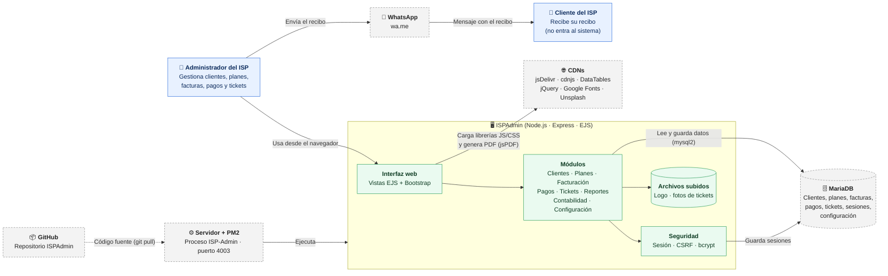

# Diagrama de contexto: ISPAdmin

Quién usa el sistema, qué hace el sistema y con qué sistemas externos se comunica.

## Actores

| Actor | Qué hace |
|---|---|
| **Administrador del ISP** | Es el único rol con usuario (tabla `administradores`). Entra con usuario y contraseña, y gestiona clientes, planes, facturas, pagos, tickets, reportes, contabilidad y la configuración. |
| **Cliente del ISP** | No entra al sistema. Es la persona que recibe el servicio de internet; le llega su recibo por WhatsApp o en PDF. |

## Sistema: ISPAdmin

| Parte | Qué hace |
|---|---|
| **Interfaz web** | Páginas EJS con Bootstrap, DataTables y SweetAlert2. |
| **Módulos** | Clientes, Planes, Facturación, Pagos, Tickets, Reportes, Contabilidad y Configuración (una ruta de Express por módulo en `src/routes/`). |
| **Seguridad** | Sesión guardada en la BD (`express-session`), protección CSRF (`csurf`) y contraseñas con `bcrypt`. |
| **Archivos subidos** | El logo del sistema (`public/img/uploads/`) y las fotos de los tickets (`public/uploads/tickets/`). |

## Sistemas externos

| Sistema | Para qué se usa |
|---|---|
| **MariaDB** | Base de datos principal. También guarda las sesiones (tabla `sessions`). |
| **WhatsApp** | Desde la factura, el botón "Enviar WhatsApp" abre `wa.me` con el mensaje del recibo para el cliente. |
| **CDNs** | El navegador descarga de ahí Bootstrap, jQuery, DataTables, SweetAlert2, Font Awesome, Chart.js, y jsPDF y html2canvas para armar el PDF del recibo. El fondo del login viene de Unsplash. |
| **Servidor + PM2** | PM2 mantiene corriendo `src/app.js` como el proceso `ISP-Admin` en el puerto 4003. |
| **GitHub** | Guarda el código y el historial. El servidor trabaja sobre una copia de este repositorio. |

> **Nota:** el PDF del recibo se genera en el navegador del administrador, no en el servidor. Por eso depende de que los CDNs estén disponibles.
