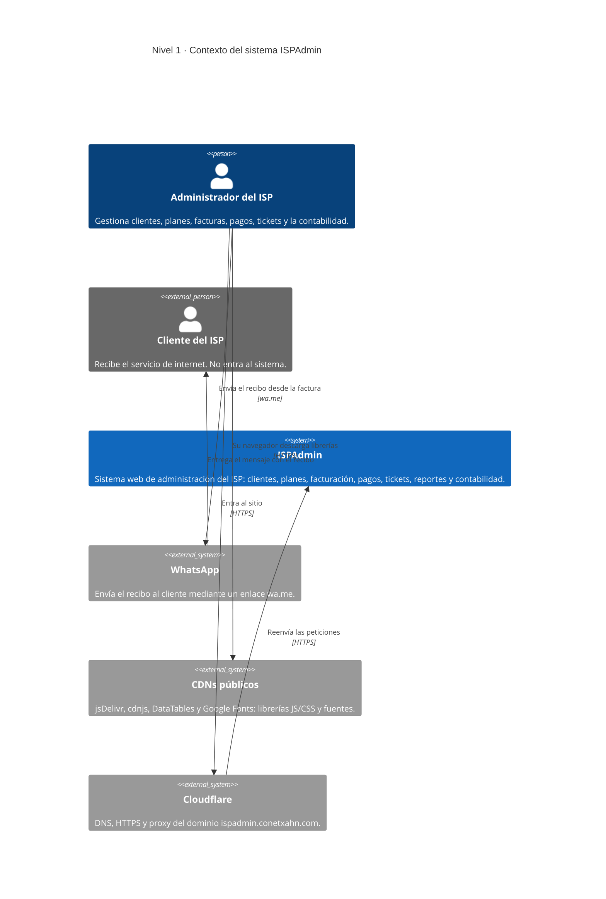
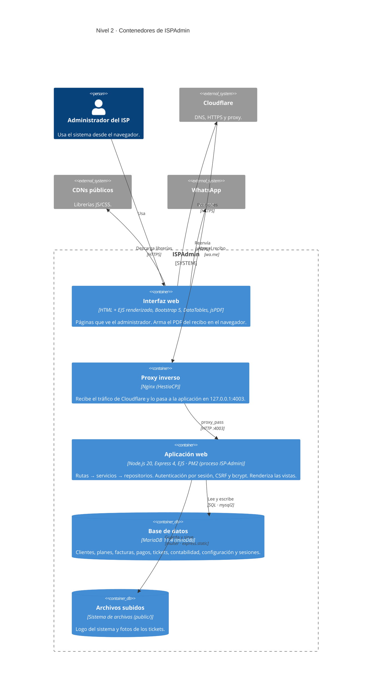

# Práctica 6 · Arquitectura de ISPAdmin (modelo C4)

ISPAdmin es el sistema web con el que un proveedor de internet (ISP) administra sus clientes, planes, facturas, pagos, tickets de soporte y contabilidad.

Este documento describe el sistema con los dos primeros niveles del [modelo C4](https://c4model.com/):

1. **Contexto:** quién usa el sistema y con qué sistemas externos se comunica.
2. **Contenedores:** qué piezas ejecutables y almacenes de datos forman el sistema, y cómo se hablan entre sí.

---

## Nivel 1 · Diagrama de contexto

### Justificación del nivel 1

| Elemento | Por qué está en el diagrama |
|---|---|
| **Administrador del ISP** | Es el único usuario con cuenta (tabla `administradores`). Todo el sistema existe para que esta persona gestione el negocio desde el navegador. |
| **Cliente del ISP** | Es a quien se le factura, pero **no** entra al sistema. Lo incluyo como persona externa porque recibe el resultado (el recibo) y explica para qué existe WhatsApp en el diagrama. |
| **ISPAdmin** | El sistema que se construyó. En este nivel es una caja negra: no importa todavía si es Express, EJS o MariaDB. |
| **WhatsApp** | El botón "Enviar WhatsApp" de la factura abre `wa.me` con el mensaje del recibo. ISPAdmin no llama a ninguna API: es el navegador del administrador el que abre el enlace. |
| **CDNs públicos** | Bootstrap, jQuery, DataTables, SweetAlert2, Font Awesome, Chart.js, jsPDF y html2canvas no se sirven desde el servidor, sino desde CDNs. Si un CDN falla, la interfaz y el PDF del recibo dejan de funcionar; por eso es una dependencia externa que vale la pena mostrar. |
| **Cloudflare** | Todo el tráfico del dominio pasa por Cloudflare antes de llegar al servidor (la respuesta HTTP trae `server: cloudflare`). Da HTTPS y oculta la IP del servidor. |

**Qué dejé fuera a propósito:** GitHub y PM2 no aparecen en este nivel. Son herramientas de desarrollo y despliegue, no sistemas con los que ISPAdmin se comunique mientras atiende a un usuario. El C4 de contexto muestra el sistema en uso, no cómo se construye.

---

## Nivel 2 · Diagrama de contenedores

### Justificación del nivel 2

| Contenedor | Tecnología | Por qué es un contenedor aparte |
|---|---|---|
| **Interfaz web** | EJS + Bootstrap + jsPDF | Corre en el navegador del administrador, no en el servidor. Ahí se arma el PDF del recibo y se abre WhatsApp, por eso esas dos relaciones salen del navegador y no de la aplicación. |
| **Proxy inverso** | Nginx | Es un proceso distinto de Node. Termina la conexión que viene de Cloudflare y la pasa a `127.0.0.1:4003`; así la aplicación nunca queda expuesta directamente a internet. |
| **Aplicación web** | Node.js 20 + Express 4 | Es el único proceso con lógica del negocio. PM2 lo mantiene vivo como `ISP-Admin` y lo reinicia si se cae. Las vistas EJS se renderizan aquí (no es una SPA), por eso la interfaz y la aplicación vienen del mismo proceso. |
| **Base de datos** | MariaDB 11.4 | Guarda todo el estado del negocio y también las sesiones (`express-session` con almacén MySQL). Usar la misma BD para las sesiones evita tener otro servicio (como Redis) para un sistema con pocos usuarios. |
| **Archivos subidos** | Disco del servidor | El logo y las fotos de los tickets no van a la BD: se guardan con `multer` en `public/` y Express los sirve como estáticos. Es un almacén distinto de la BD, con su propio respaldo. |

### Decisiones que se ven en este nivel

- **Monolito con capas, no microservicios.** Un solo proceso Express con capas internas (rutas → servicios → repositorios). Para un equipo de una persona y un ISP pequeño, un monolito es más simple de desplegar y depurar.
- **Solo los repositorios tocan la base de datos.** Es la **D de SOLID** (inversión de dependencias): las rutas y los servicios no escriben SQL, reciben sus repositorios. Así la base de datos queda como un detalle del contenedor "Base de datos" y la lógica se puede probar sin ella. El módulo de eliminación de clientes ya funciona así; el resto de los módulos se migra en los PR #8 a #16, que agregan `npm run check:db` para revisar la regla.
- **Renderizado en el servidor (EJS).** Evita mantener una API y un frontend por separado. El costo es que algunas pantallas dependen de librerías en CDNs.
- **PDF en el navegador.** Generar el recibo con jsPDF en el cliente evita instalar un motor de PDF (como Puppeteer) en el servidor.

---

**Código de verificación:** `LEARN-CAP-7AA6B634`
